<!-- Replace these placeholders before publishing -->

# ✦ Vikash-Business ✦

### `AI FOUNDER` · `AUTOMATION` · `SOFTWARE`

 

*Building useful technology, one project at a time.*

---

## 🧬 About Me

- 🚀 Interested in building AI-powered products and digital tools.
- 🧠 Exploring AI models, intelligent agents, and automation.
- 🛠️ Working with software development tools and modern technologies.
- 🌌 Focused on turning ideas into practical projects.

> *Think beyond the interface. Build beyond the ordinary.*

## ⚡ Technology Stack

### Languages, Frameworks & Tools

  

<!-- HEADER -->

  

<!-- ABOUT -->

  

<!-- SKILLS -->

  

<!-- FOOTER -->

  

## 🚀 Featured Projects

<!-- Add your real projects below. Remove this comment when ready. -->
*Meal Mentor AI*
and many more *upcoming*.

### `BUILD · LEARN · ITERATE`

*The next idea could become the next great product.*
*Ready to build with me*
 *Contact :- vikash.info.business@gmail.com*

